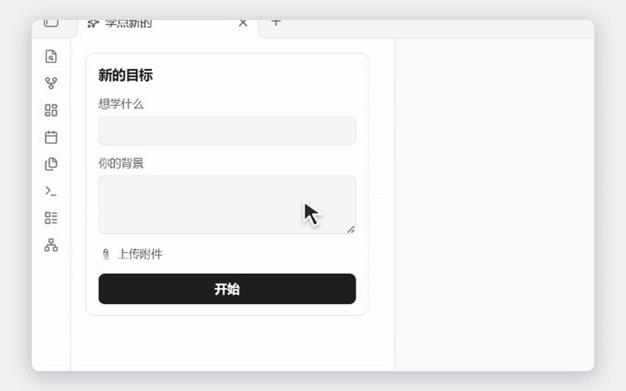
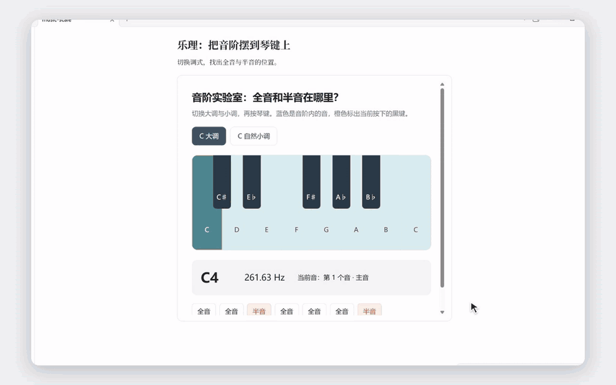
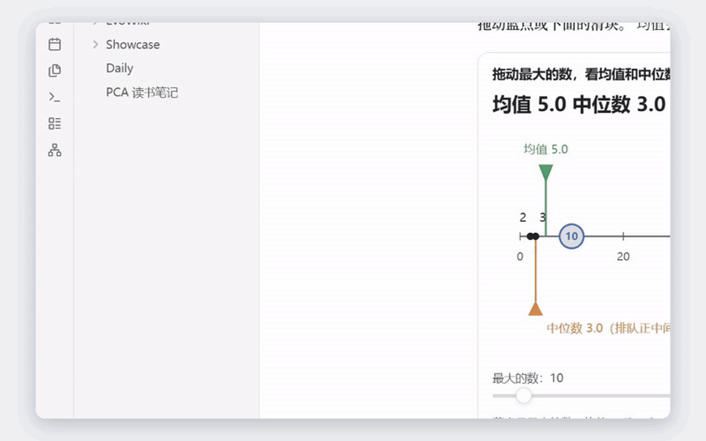
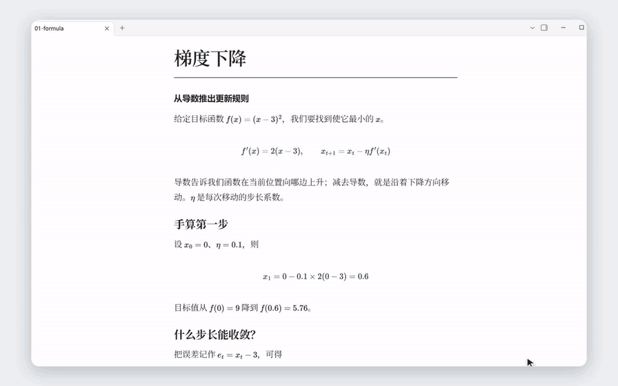
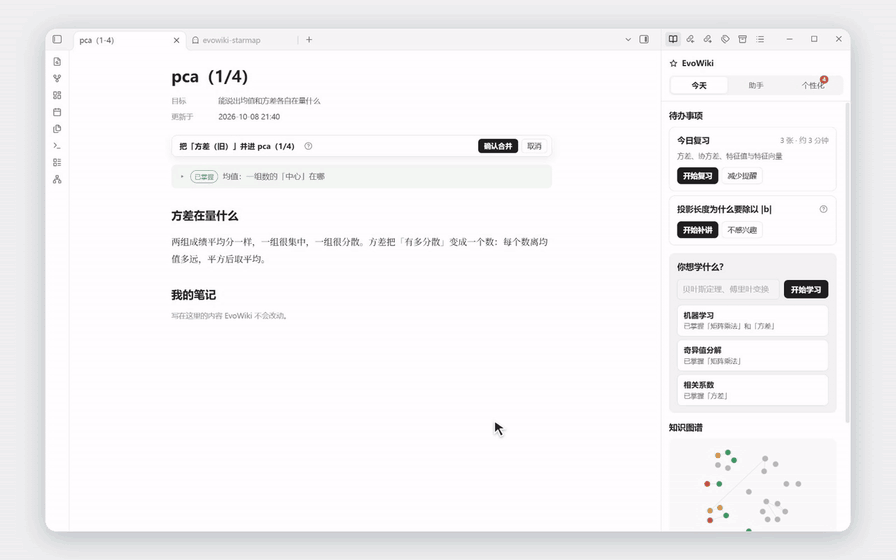
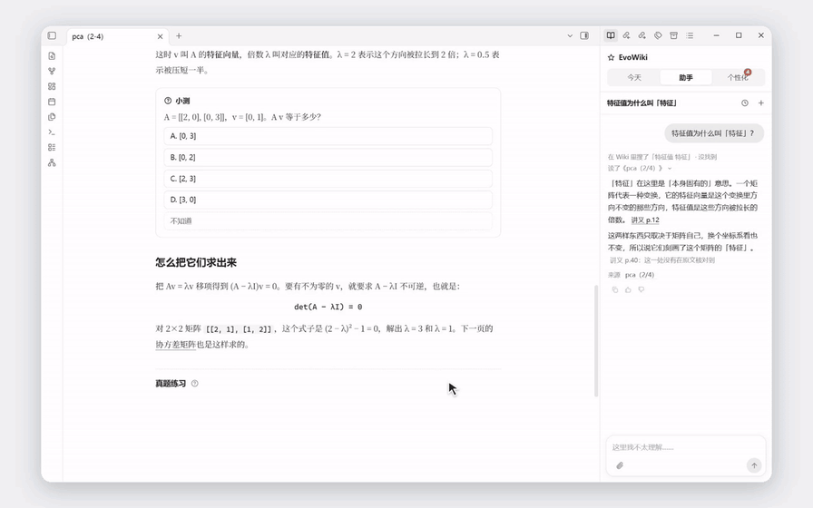

# 🧠 EvoWiki — Let AI teach you, not just answer you

[中文](README.md) · English

### 🚫 In the age of AI, stop learning the hard way!

📚 **Textbooks that just recite the material** — Pages of jargon, and you are still lost.

📊 **Slides with a single sentence per page** — Dozens of slides, barely any useful information.

🎥 **Three-hour online lectures** — Plenty of time spent listening, but the part you actually need never seems to arrive.

### 💡 Learning in the age of AI should be better.

**Ask when you are stuck. Learn what you need. Go deeper whenever you want.**

Talk with AI in real time and let your questions guide your learning, instead of following textbook chapters, slide numbers or video progress bars.

But have you noticed that **asking AI directly brings its own frustrations?**

- ❌ **Jargon explaining jargon:** Ask about one unfamiliar concept and get ten harder ones in return.
- ❌ **Too shallow or too deep:** AI never quite knows what you already understand or what you are missing.
- ❌ **Learn it, then lose it:** After hours of questions, it finally clicks. Days later, you cannot even find the explanation that helped.
- ❌ **Knowledge scattered everywhere:** Your chat history grows, but what you learn never becomes a connected body of knowledge.

---

## ✨ EvoWiki: From one-off conversations to a personal knowledge base that keeps evolving

**🎯 Set a goal → 🧠 Understand your starting point → 📖 Get explanations made for you → 💬 Ask as you learn → 🔄 Give feedback and review**

EvoWiki is a desktop AI learning wiki built on **Obsidian**. It does more than generate a textbook: it creates explanation pages around your learning goals and what you already know.

Read directly in your notes, interact with examples, answer questions, ask follow-ups, give feedback, continue learning or review at any time.

**Make every AI explanation part of your personal knowledge system, instead of letting it disappear into chat history.**

---

## 🚀 Ready to use, without wrestling with environments

- 🪟 **Windows 11 x64** · One-click startup
- 🔒 **Local first** · Markdown notes and PostgreSQL learning records stay on your computer
- 🧩 **Runs on CPU** · No dedicated GPU required
- 🤖 **Multiple model providers** · Claude / DeepSeek / OpenAI / Gemini / Kimi / GLM / OpenAI-compatible APIs
- ⚡ **Expand when needed** · GPU, search, local OCR and automatic code changes are optional

📌 First use requires an Internet connection to download dependencies and an API key from at least one supported model provider. Model API charges are billed by that provider.

---

### 🌱 More than answers from AI: turn knowledge into abilities you can use.

**EvoWiki — Learn with AI. Build what you know.**

## What EvoWiki can do

### Start with your goal and find your starting point

Describe what you want to learn and what you already know, confirm a learning path, then take an initial assessment to find the right place to begin. Topics and their connections appear in a knowledge graph.



### Understand by doing, not just reading

EvoWiki goes beyond text. Its innovative UI system lets an LLM generate a wide range of interactive components suited to teaching and understanding.



### A personal knowledge base that grows as you learn

Explanations stay in Obsidian as Markdown, building your own collection of notes by topic. Return to older pages and connect new knowledge with what you have already learned.



### Organize knowledge the way you like

Prefer derivations? Read the full formulas. Prefer intuitive explanations? Use charts. With Obsidian, choose fonts, backgrounds, columns and links that make the content and reading experience work together. EvoWiki's powerful memory system remembers your reading preferences.



### Open it and see what to review today

Start with the review cards in **Today**: recall first, check the answer, then answer questions to see whether you really remember.



### Turn dissatisfaction into concrete improvements

Point out what you did not understand. The assistant proposes specific changes and, once you confirm, writes them back to the page. Explanations that work for you can become lasting personal preferences.

EvoWiki includes an RSI self-improvement system that helps the whole system understand you better across different dimensions the more you use it!



## Technical overview

### 🎛️ EvoUI: Let AI generate learning material you can interact with

**Why should AI only explain a formula when it could generate an experiment you can try yourself?**

EvoUI takes AI beyond text and static images to interactive teaching interfaces. When learning gradient descent, drag the learning rate and watch the parameters move. When learning matrix transformations, manipulate a shape and see the transformation happen.

AI does not need to build a web page from scratch each time. EvoUI packages interaction logic into reusable components; the model only needs to choose a component and generate its configuration.

- **18 built-in components**, 13 with configurable parameters, covering functions, matrices, graph traversal, random simulations and interactive exercises.
- **Declarative interaction generation** reuses existing logic and styles; more complex interactions can use sandboxed mini-apps.
- **Interaction results feed into the learning system:** answers and interaction feedback can update learning state directly.

Compared with generating standalone HTML, output tokens are reduced by about **72%** and API request latency by about **82%**.

**EvoUI's core value is making interactive software itself into teaching material that AI can quickly generate, combine and reuse.**

### 🧠 K: Let AI know what you have actually learned

**Does answering a question correctly really mean you understand?**

You might apply a formula without understanding why it works, or remember a concept without knowing when to use it. Ordinary chat history struggles to capture these differences accurately. EvoWiki introduces learning state K for this purpose.

For each knowledge point, it tracks abilities such as terminology, uses, formulas, calculation, interpreting results and deriving principles. It distinguishes direct answers, user statements and inferences from related knowledge. Each judgment retains both a mastery estimate and its uncertainty.

Going further, **even the way AI judges your understanding can be tested against data.**

A1 fits evidence weights, guessing, carelessness and forgetting parameters from historical answers. A2 compares alternatives and validates them against records held out by time. FSRS-6 separately manages memory retention and review scheduling.

K grounds teaching decisions in accumulated learning evidence, rather than the model's impression of a conversation.

### 🌙 Dreaming: Let AI build lasting experience

**A longer chat history does not mean AI knows you better.**

After dozens of learning sessions and hundreds of exercises, important information can be scattered across conversations. Putting everything into context is expensive and introduces irrelevant information; simply cutting it short loses key experiences.

Inspired by [Claude Dreaming](https://www.anthropic.com/research/components-of-agent-memory), EvoWiki gives its agents a background memory consolidation mechanism.

- **Remember learning experiences.** Consolidate changes in mastery, past misconceptions and unresolved questions across sessions. New sessions read relevant summaries and trace back to original records when needed.
- **Remember system improvements.** Consolidate the reasons, tests, effects and rollback results of changes, so future improvements can draw on past experience.
- **Keep memories traceable and up to date.** Retain sources and versions, update relevant summaries when original records change, and avoid pointless repeated processing.

### 🧬 RSI: Let AI improve how it works by learning from mistakes

**If AI keeps making the same mistake, why should you have to correct it every time?**

Ordinary AI usually responds to negative feedback by changing the current answer. The next time a similar issue arises, its prompts, tools and execution strategy may be exactly the same.

Drawing on [Harness²](https://arxiv.org/abs/2610.14224), EvoWiki builds a controlled RSI mechanism. The improver can read execution traces, user feedback, current configuration and historical experiments to identify whether a problem comes from prompts, tools, context or the execution process.

It can then propose changes to:

- Prompts, teaching strategies and examples.
- Tool descriptions, invocation steps and context strategies.
- Model configuration, execution budgets, and candidates for new tools or application code.

**Making a change does not automatically make it an improvement.** Candidates can first replay historical tasks and compare results, then go through checks and approval. Results continue to be recorded after adoption, with support for undoing and rolling back changes.

The goal is to turn user feedback into verified system improvements over time, beyond temporary adjustments to the next answer.

### ⚙️ Agent Runtime: One engine for the whole learning system

**Reading, writing, practice, memory consolidation and system improvement do not need five separate agent engines.**

Inspired by [Pi](https://github.com/earendil-works/pi), EvoWiki unifies core execution into:

**Model decision → Tool call → Get results → Continue execution**

Agents have different responsibilities through their prompts, skills, tool permissions and stopping conditions. The shared Runtime handles:

- **Gateway:** Unified model calls, caching, budgets, usage and execution tracing.
- **Skills:** Load tools on demand and check invocation permissions.
- **Context management:** Compress long conversations and tool results while preserving important execution information.
- **Durable execution:** Pause, wait for user replies and resume tasks, using DBOS to save progress.

### 🤖 Bot: Let the same agents take initiative

Bot is the proactive mode of the same runtime, rather than a separate agent architecture. Traditional agents wait for a user message. Bot can also be triggered by learning events or scheduled rules.

Repeated mistakes on a knowledge point can prompt a suggestion for another explanation. Reviews coming due can trigger a recap. Repeated negative feedback can trigger an improvement review when RSI is enabled.

All proactive actions are subject to authorization, deduplication, cooldowns and limits on the number of reminders.

**The same agents can answer your questions and proactively decide what to do next based on your learning state.**

## First installation

Install [Git for Windows](https://git-scm.com/install/windows), [uv](https://docs.astral.sh/uv/getting-started/installation/), [Node.js 22 or newer supported LTS with npm](https://nodejs.org/en/download), [Obsidian Desktop 1.15 or newer](https://obsidian.md/download), and the [Microsoft Visual C++ v14 x64 runtime](https://aka.ms/vc14/vc_redist.x64.exe). Use the complete official Git installer: local PostgreSQL needs its runtime DLLs. Reopen PowerShell after installing.

Confirm that `git --version`, `uv --version`, `node --version` and `npm --version` work. You do not need to install Python or PostgreSQL manually. Dependencies, the browser, database components and embedding model take several GB; notes, source material and backups need additional space.

PostgreSQL needs Git's `libwinpthread-1.dll`. The launcher locates its actual directory through `git --exec-path` and passes it only to this instance's database process, without changing the system PATH or copying DLLs from other applications. `doctor` checks it; if missing, reinstall the complete official Git distribution and reopen your terminal.

The Visual C++ runtime is a [Windows prerequisite for ONNX Runtime](https://onnxruntime.ai/docs/install/), including CPU embeddings. Run Microsoft's installer and accept the administrator prompt; without administrator access, ask your administrator to install it. After reopening the terminal, `doctor` checks the system runtime and names missing DLLs with the official download address. It does not elevate privileges automatically or copy DLLs from other applications.

Choose a project folder, for example on drive D:

```powershell
git clone https://github.com/jiaruihu984/EvoWiki.git EvoWiki
cd EvoWiki
uv run --isolated --no-project --with python-dotenv==1.2.4 python scripts/evowiki_run.py init --language en
uv run --isolated --no-project --with python-dotenv==1.2.4 python scripts/evowiki_run.py doctor --language en
uv run --isolated --no-project --with python-dotenv==1.2.4 python scripts/evowiki_run.py up --language en
```

Use `--language en` or `--language zh` to choose launcher messages; without it, the launcher follows the system locale. The chosen language is inherited by its child control processes. Chinese characters and spaces in folder names are supported. Configuration files use UTF-8. The launcher downloads Python dependencies, PostgreSQL and Chromium when needed; expect several GB of disk use. The local embedding model downloads on first use. Installation checks and setup checks do not make paid model requests.

`init` creates `.env` and an independent empty Obsidian vault at `.evowiki-vault`, preserving existing files. The separate lightweight launcher environment avoids updating a running project's dependencies before startup. You can start without an API key. When the local service is ready, open the printed vault path in Obsidian, allow community plugins and enable EvoWiki. Complete **Initial setup** to choose English or Chinese, configure a model provider, and confirm your background, budget and automation permissions. Without a model key, local components can still become ready while learning capabilities show as unconfigured.

The local launcher saves settings to this instance's main `.env`, then restarts the backend through its normal drain procedure. Leaving a key blank preserves it; old keys are never shown. Do not put keys in chat, screenshots, issues or Git. You can also configure providers in the main `.env` beforehand; see `.env.example` and [local configuration and recovery](docs/first-use-setup.en.md).

OpenAI, Gemini, Kimi and GLM use OpenAI-compatible APIs. Default endpoints are in `.env.example`. For your own proxy, set `OPENAI_BASE_URL`, `GEMINI_BASE_URL`, `MOONSHOT_BASE_URL` or `ZAI_BASE_URL` respectively. For a custom service, set `EVOWIKI_RUNTIME_PROVIDER=openai_compatible` together with `EVOWIKI_COMPATIBLE_API_KEY`, `EVOWIKI_COMPATIBLE_BASE_URL` and `EVOWIKI_COMPATIBLE_MODEL`. API keys are sent to the configured service address, so make sure you trust it.

Below the chat input, choose a provider, specific model and reasoning level separately. Use `EVOWIKI_<PROVIDER>_MODELS` for a comma-separated model list (`KIMI` for Kimi, `GLM` for GLM and `COMPATIBLE` for custom services), and the corresponding `_MODEL` for the default. Providers without keys are unavailable. Old `claude` and `deepseek` selections require choosing a specific model again; they are not automatically replaced. Unknown models offer only API-default reasoning. Set `EVOWIKI_COMPATIBLE_VISION=true` only after confirming that your custom compatible model supports images. Chat images follow model capabilities; scanned pages still need Claude vision or local OCR. See [multi-provider model configuration](docs/multi-api.md) for settings, reasoning constraints and pricing files.

Additional or custom models need prices as well as an entry in `_MODELS`. Set `EVOWIKI_PRICES_FILE` to a UTF-8 TOML file and enter actual prices in USD per million tokens using the `[models."provider:model-name"]` format in `src/evowiki/llm/prices.toml`. Use the canonical provider IDs described above. Missing prices cause the selector to show the specific reason a model is unavailable.

Afterward, double-click **EvoWiki.exe** and manage services through the Windows notification area. Right-click its icon to open the vault, view status and logs, or start, stop or restart. **Stop service and exit** cleanly stops the backend and this instance's owned database. `doctor` returns a nonzero exit code for missing requirements. Configuration checks are free and do not verify key balances or model permissions. The first `up` downloads Python dependencies, PostgreSQL and Chromium according to lock files and checks built-in components. Follow terminal progress; address reported errors before retrying. Completed resources are reused.

When the service reports **Ready**, open the printed vault path in Obsidian, allow community plugins and confirm EvoWiki is enabled. If port 8002 is occupied, another port is selected and the plugin address is updated. If Obsidian was open during installation or upgrade, restart it or reload the plugin.

## Data safety

The service is for local use only and is not exposed to the public Internet. The local username distinguishes records; it is not cloud login authentication.

| Action | Data sent and recipient | Default |
|---|---|---|
| Planning, explanations, assistant, feedback interpretation, memory consolidation | Goals, conversations, notes or source excerpts needed for the task go to the currently configured and selected model provider; the entire vault is not uploaded automatically | Required for core model features |
| Vector retrieval | The model is downloaded from a model repository on first use; text embeddings are computed locally | CPU, no cloud embedding API |
| Web search | Search terms go to Tavily, and result websites are accessed | Off without a key |
| Images and scanned pages | Claude vision receives selected images/pages; separate local OCR processes them locally | Depends on capability configuration; not required for plain text |
| Phoenix / OpenTelemetry | Exported traces may contain task content | Off in new configuration, with `EVOWIKI_OTEL_ENDPOINT` empty |
| RSI, tool generation and code changes | When enabled, relevant feedback and change evidence go to the model, and repository checking tools can run | Automatic RSI off; `EVOWIKI_FORGE=off` disables generation/modification |

Forgetting removes corresponding local records and derived content. An external ledger prevents old backups from reviving it. It cannot retract data already received by providers or delete separately saved notes or third-party backups. Provider data retention follows each provider's policy.

## Daily operation and upgrades

Double-click **EvoWiki.exe** to start or reuse the owned healthy service. Choose **Stop service and exit** from its tray menu to drain and stop it. Restart or reload the Obsidian plugin after installation or an update.

```powershell
uv run --isolated --no-project --with python-dotenv==1.2.4 python scripts/evowiki_run.py status --language en
uv run --isolated --no-project --with python-dotenv==1.2.4 python scripts/evowiki_run.py down --language en
git pull --ff-only
uv run --isolated --no-project --with python-dotenv==1.2.4 python scripts/evowiki_run.py up --language en
```

Stopping waits for requests and durable tasks to finish and reports an error if they cannot drain safely. `down --db` also stops an independently owned PostgreSQL process while preserving Windows database services that might be shared.

For upgrades, the launcher verifies ownership, stops the old backend, backs up and migrates, and installs matching backend and plugin versions. Failures are not reported as success. Protocol mismatches require upgrading. If local changes prevent a pull, save your changes; do not force-reset. After database upgrades, do not run old code that cannot understand the database. Restore into a new database to roll data back. Ordinary upgrades do not need the live supervisor.

For troubleshooting, `doctor` checks installation; `status` shows the instance, commit, port and plugin build. `<service-address>/health/ready` checks database migrations, runtime and forgetting recovery; the system is unavailable when it returns 503. `/health/capabilities` shows optional capability requirements. Plugin settings show backup success or failure and let you retry. Logs are in `.evowiki-run/backend.log`; check terminal output first for download errors. Issues should include only necessary redacted errors, versions and the stage that failed. Do not upload `.env`, full logs, databases, original conversations or source material.

## Backup and restore

Database backups run every 24 hours and retain the latest 14 copies by default. A backup also runs before migrations.

```powershell
uv run --isolated --no-project --with python-dotenv==1.2.4 python scripts/evowiki_run.py backup --language en
uv run --isolated --no-project --with python-dotenv==1.2.4 python scripts/evowiki_run.py backups --language en
```

A complete backup contains matching `.dump`, `.ledger.jsonl` and `.manifest.json` files; keep them together. The default location is `.evowiki-run/backups`. Change it with `EVOWIKI_BACKUP_DIR`, or set it to `off` to disable backups. Disabled backups are not shown as protected. Backups contain private content, so keep them somewhere trusted.

**A database backup is not a full-computer backup.** Back up vault notes and attachments, `.env`, and the latest `.evowiki-run/forget-ledger.jsonl` (or the file specified by `EVOWIKI_FORGET_LEDGER`) separately. Never overwrite the latest forgetting ledger with an older version. Model caches can be downloaded again.

First run a restore check, replacing the example paths and names:

```powershell
uv run --isolated --no-project --with python-dotenv==1.2.4 python scripts/evowiki_run.py restore-check --backup "D:/Backups/selected-backup.dump" --database evowiki_restore_check --target-dir "D:/EvoWiki-restore-check" --ledger "D:/Backups/latest-forget-ledger.jsonl" --language en
```

This creates a new database and directory, checks files, migrations and content, replays the latest forgetting ledger and verifies application reads. It does not switch configuration and retains the check database for inspection. For the actual restore, choose another new database and directory that do not yet exist and explicitly confirm:

```powershell
uv run --isolated --no-project --with python-dotenv==1.2.4 python scripts/evowiki_run.py restore --backup "D:/Backups/selected-backup.dump" --database evowiki_restored --target-dir "D:/EvoWiki-restored" --ledger "D:/Backups/latest-forget-ledger.jsonl" --confirm --language en
uv run --isolated --no-project --with python-dotenv==1.2.4 python scripts/evowiki_run.py up --language en
```

The actual restore stops this instance first and changes `.env` only after validation succeeds, pointing it to the new database and merged ledger. The original database and vault are preserved. Missing or corrupt ledgers, unsupported versions or unsupported extensions cause failure. Backups with migration `0082` or later applied can be upgraded to the current code if their migration history is a complete prefix of the current code's history. PostgreSQL downgrades are unsupported. Empty snapshots taken before first-install migrations contain no user data and are not product restore backups. The target needs pgvector and an administrator connection permitted to create roles and databases; the local cluster created by one-click setup already provides these. Moving to another computer also requires restoring the vault and configuration separately.

## Data locations and uninstalling

All paths below are relative to the project directory. Choose your own installation location.

| Content | Default location | Default uninstall behavior |
|---|---|---|
| Secret configuration | `.env` | Kept |
| Database and components | `.pgdata`, `.pg18` / download cache | Kept |
| Note vault | `.evowiki-vault` or `EVOWIKI_VAULT` | Kept |
| Backups and forgetting ledger | `.evowiki-run/backups`, `.evowiki-run/forget-ledger.jsonl` | Kept |
| Python/npm environments | `.venv`, `obsidian-plugin/node_modules` | Can be explicitly removed |
| Plugin configuration | `vault/.obsidian/plugins/evowiki/data.json` | Kept |

Close Obsidian if it is using this vault so the plugin is no longer saving configuration or notes. Preview first, then apply:

```powershell
uv run --isolated --no-project --with python-dotenv==1.2.4 python scripts/evowiki_run.py uninstall --language en
uv run --isolated --no-project --with python-dotenv==1.2.4 python scripts/evowiki_run.py uninstall --apply --language en
```

Uninstall removes plugin files owned by this instance that have not been replaced externally, removes autostart and EvoWiki from the enabled-plugin list, preserves other plugins and stops this instance's backend. If another installation replaced the files, the entire plugin and its enabled state are preserved. Add `--remove-runtime` to clean the project's Python/npm environments; this first stops the instance's independently owned PostgreSQL process. Removal is refused if other processes still use the runtime. Use the isolated commands above to avoid deleting the interpreter executing the uninstall.

To completely remove the default vault, configuration and independent database, back up first and run `down --db`. Preview with `uninstall --delete-data --confirm-delete-root "absolute-repository-path" --language en`, then add `--apply` after checking the result. Databases without ownership records, still running or managed by a Windows service are not deleted. Custom vaults, shared caches, backups and ledgers remain for you to manage separately. After a normal uninstall, running `up` reconnects retained data and re-enables EvoWiki in the default vault created by this instance. In an existing vault you specified yourself, manually allow and enable the plugin again in Obsidian.

## Optional features, development and licensing

Set `TAVILY_API_KEY` for search. GPU embeddings require an NVIDIA driver. Stop the service, set `EVOWIKI_EMBED_PROVIDERS=cuda` and restart; an actual CUDA session is checked. Local OCR needs a separate environment; see [runtime documentation](docs/runtime.md). WASI tools require explicit enablement before running `uv run --no-sync python scripts/fetch_wasi_python.py`.

Enable autostart with `powershell -ExecutionPolicy Bypass -File scripts/evowiki_autostart.ps1 -Enable`; use `-Disable` to turn it off. See [docs/runtime.md](docs/runtime.md) for manual cross-platform operation and the [plugin guide](obsidian-plugin/README.md) for plugin use. Equivalent one-click validation is not claimed for non-Windows platforms.

Development checks: Ruff, relevant pytest tests, and the plugin's `npm ci`, lint, typecheck, test and build. Windows clean-checkout checks are in `.github/workflows/product-windows.yml`. `uv run --no-sync python scripts/check_secrets.py --download` scans files intended for commit and all reachable history, reporting only redacted metadata. Real learning validation also needs real Obsidian and an authorized model; see the tested scope in the [Windows product verification record](docs/product-verification.md).

Original code is licensed under [MIT](LICENSE), allowing commercial use. Third-party code follows its respective licenses; see [third-party notices](THIRD_PARTY_NOTICES.md). This does not include licenses for Obsidian or model services.

See [desktop source and build provenance](desktop/README.md) for source, build instructions and file hashes. `EvoWiki.exe` is unsigned; use normal security review without disabling protection or adding exclusions.
