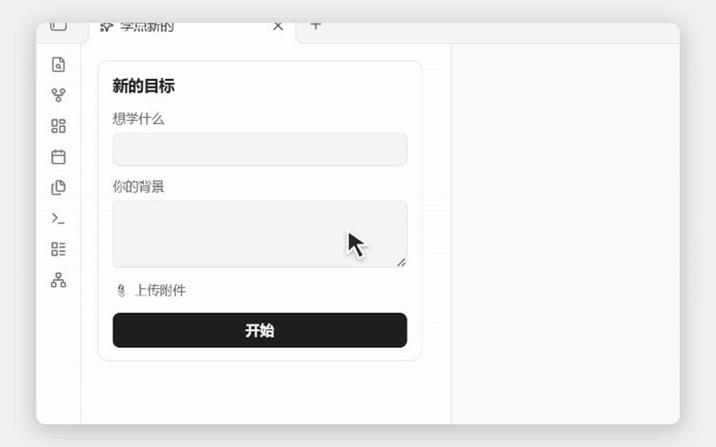
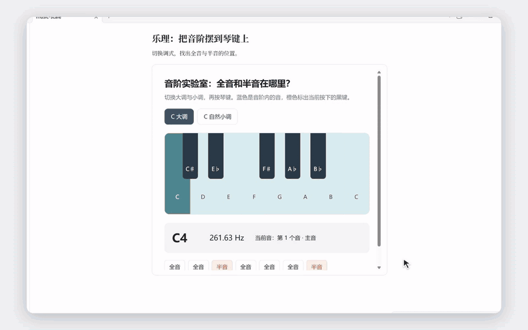
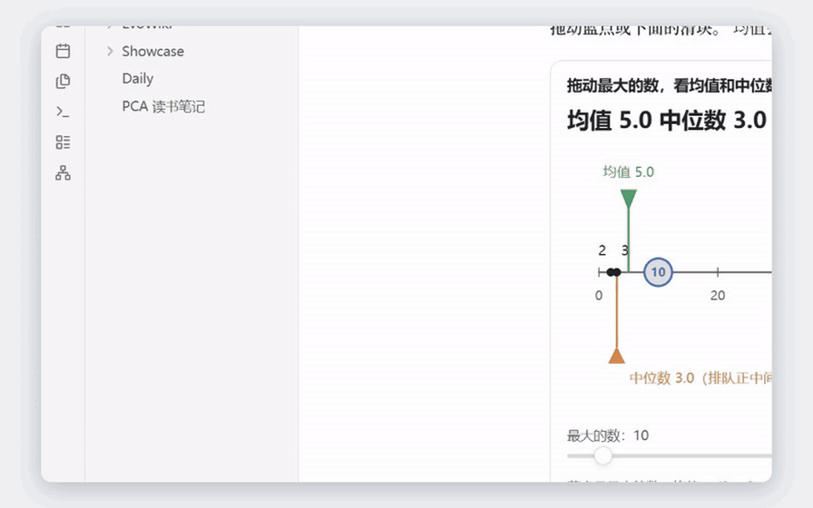
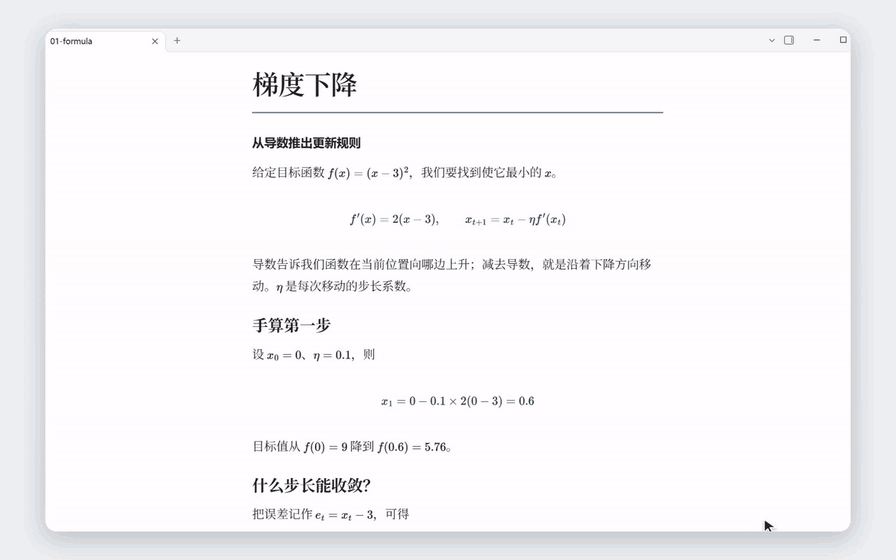
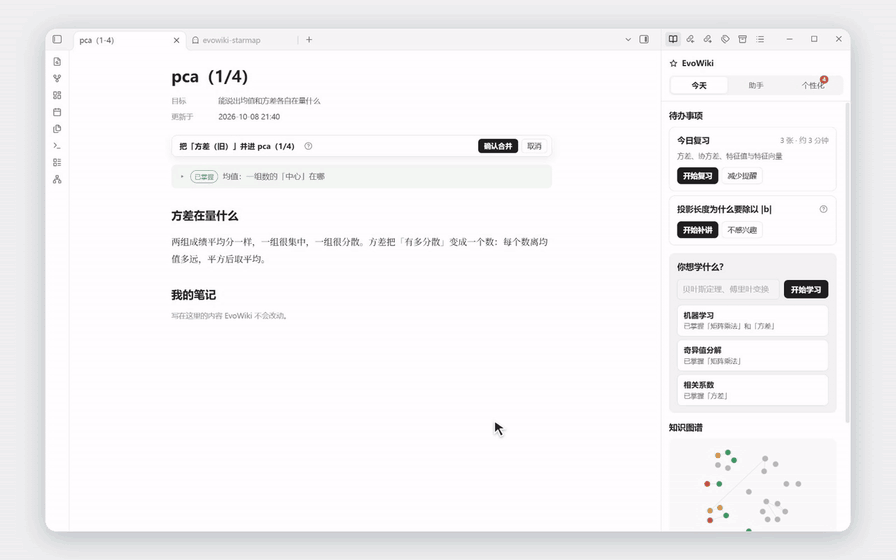
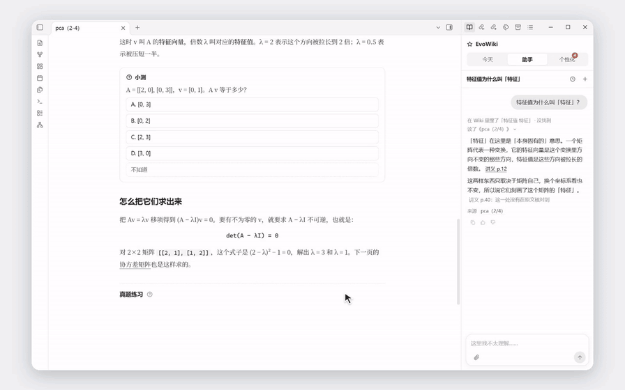

# 🧠 EvoWiki — 让 AI 真正教会你，而不只是回答你
[English](README.en.md) · 中文
### 🚫 AI 时代，别再用低效的方式学习了！

📚 **照本宣科的教材** —— 满篇术语，看了半天还是一头雾水。

📊 **一页只有一句话的 PPT** —— 翻了几十页，真正有用的信息却寥寥无几。

🎥 **动辄 3 小时的网课** —— 时间花了不少，废话听了一大堆，真正想知道的却迟迟讲不到。

### 💡 AI 时代，学习本该有更好的方式。

**不懂就问，哪里不会学哪里，想深入就深入。**

与 AI 实时交流，让学习围绕你的疑问展开，而不是被教材的章节、PPT 的页数和视频的进度条牵着走。

但你是否发现，**直接问 AI，也有新的烦恼？**

- ❌ **术语套术语**：问一个不懂的概念，AI 却用十个更难的概念来解释。
- ❌ **讲得太浅或太深**：AI 总是不知道你已经懂什么、还缺什么。
- ❌ **学完就忘**：花几个小时追问，终于弄懂了，过几天却连当时怎么理解的都找不到。
- ❌ **知识散落各处**：聊天记录越来越长，学到的东西却始终没有形成自己的知识体系。

---

## ✨ EvoWiki：从「一次性对话」到「持续进化的个人知识库」

**🎯 设定目标 → 🧠 了解你的基础 → 📖 生成专属讲解 → 💬 边学边问 → 🔄 反馈与复习**

EvoWiki 是一款基于 **Obsidian** 的桌面端 AI 学习 Wiki。

它不只是生成一篇教材，而是围绕你的学习目标和已有知识，生成适合你的讲解页面。

你可以直接在笔记中阅读、操作示例、答题、追问、反馈，继续学习或随时复习。

**让 AI 的每一次讲解，都成为你个人知识体系的一部分，而不是淹没在聊天记录里。**

---

## 🚀 开箱即用，不折腾环境

- 🪟 **Windows 11 x64** · 一键启动
- 🔒 **本地优先** · Markdown 笔记与 PostgreSQL 学习记录保存在本机
- 🧩 **纯 CPU 可运行** · 无需独立显卡
- 🤖 **多模型支持** · Claude / DeepSeek / OpenAI / Gemini / Kimi / GLM / OpenAI 兼容接口
- ⚡ **按需扩展** · GPU、搜索、本地 OCR、自动修改代码均为可选功能

📌 首次使用需要联网下载依赖，并自备至少一家支持的模型 API Key。模型 API 费用由相应服务商收取。

---

### 🌱 不只是让 AI 回答你的问题，而是让知识真正成为你的能力。

**EvoWiki — Learn with AI. Build what you know.**
## EvoWiki 能做什么

### 从目标出发，先摸清起点

说出想学什么、已经会什么，确认学习路径，再通过摸底找到适合自己的起点。学习主题和它们的联系会呈现在知识图谱中。



### 动手理解，不只阅读

Evowiki不止文字，创新UI系统可以让LLM生成多种多样适合教学理解的可操作组件帮助学习。



### 越学越完整的个人知识库

讲解以 Markdown 留在 Obsidian 中，按主题积累成自己的笔记目录。随时切回旧页面，把新知识和已经学过的内容连起来。



### 按自己的习惯组织知识

喜欢推导，就看完整公式；喜欢直观解释，就用图表。依托obsidian，你可以采用不同的字体、背景、分列与链接，让内容和阅读方式相互适应。
Evowiki具有强大的记忆系统，可以记住你的阅读偏好



### 今天该复习什么，打开就知道

从“今天”的复习卡片开始，先回忆、再核对答案，并用答题检查自己是否真正记住。



### 把不满意变成具体改进

直接指出哪里没讲懂，让助手提出具体改法，确认后写回页面。合适的讲解方式也可以留下来，作为以后的个人偏好。
Evowiki配有RSI自进化系统，让整个系统从各个维度上越用越懂你！



## 首次安装

先安装 [Git for Windows](https://git-scm.com/install/windows)、[uv](https://docs.astral.sh/uv/getting-started/installation/)、[Node.js 22 或更新的受支持 LTS 版（含 npm）](https://nodejs.org/en/download)和 [Obsidian 桌面版 1.15.0 或更新版](https://obsidian.md/download)。重新打开 PowerShell，确认 `git --version`、`uv --version`、`node --version`、`npm --version` 均能运行。不需要手动安装 Python 或 PostgreSQL。依赖、浏览器、数据库组件和向量模型会占数 GB，笔记、资料及备份另算。

请使用完整的官方 Git for Windows 安装版：本地 PostgreSQL 也需要它提供的 `libwinpthread-1.dll` 运行库。启动器通过 `git --exec-path` 定位实际目录，仅传给本实例的数据库进程，不修改系统 PATH、不复制其他应用的 DLL。doctor 会检查运行库；缺少时重新安装完整 Git，并重新打开终端。

还需安装 [Microsoft Visual C++ v14 x64 运行库](https://aka.ms/vc14/vc_redist.x64.exe)，这是 [ONNX Runtime 的 Windows 前置要求](https://onnxruntime.ai/docs/install/)，CPU 向量模型也需要。运行微软安装程序并接受管理员批准；没有管理员权限时请联系管理员安装。重新打开终端后，doctor 会检查系统运行库，缺少时给出具体 DLL 名称和官方下载地址，不会自动提权或复制其他应用的 DLL。

在希望保存项目的位置打开 PowerShell，例如 D 盘的 Apps 目录：

```powershell
git clone https://github.com/jiaruihu984/EvoWiki.git
cd EvoWiki
uv run --isolated --no-project --with python-dotenv==1.2.4 python scripts/evowiki_run.py init
```

路径可以有中文或空格。`init` 创建 `.env` 和独立空白库 `.evowiki-vault`，已有文件不覆盖。独立的轻量启动环境用于避免启动前更新正在运行的项目依赖。

无需先填密钥：直接启动本地服务，在 Obsidian 的“首次设置”中选择语言、填写模型 API，并确认背景、预算和自动化权限。检查配置不调用付费模型；没有模型密钥时本地组件仍可就绪，学习能力显示未配置。设置由本机启动器保存到当前实例主 `.env`，保存后按正常排空流程重启后端；留空保留密钥，不会回显旧密钥。不要把密钥发到聊天、截图、issue 或 Git。也可事先在主 `.env` 配置供应商；具体字段见下文和 `.env.example`。[本机配置协议与恢复](docs/first-use-setup.en.md)。

OpenAI、Gemini、Kimi 和 GLM 通过 OpenAI 兼容接口访问，默认地址见 `.env.example`；如需自己的代理地址，可分别设置 `OPENAI_BASE_URL`、`GEMINI_BASE_URL`、`MOONSHOT_BASE_URL`、`ZAI_BASE_URL`。自定义服务使用 `EVOWIKI_RUNTIME_PROVIDER=openai_compatible`，同时填写 `EVOWIKI_COMPATIBLE_API_KEY`、`EVOWIKI_COMPATIBLE_BASE_URL` 和 `EVOWIKI_COMPATIBLE_MODEL`。API key 会发给配置的服务地址，务必确认地址可信。

对话输入框下方可分别选择厂商、具体模型和思考强度。用 `EVOWIKI_<供应商>_MODELS` 配置逗号分隔的模型清单（Kimi 使用 `KIMI`，GLM 使用 `GLM`，自定义服务使用 `COMPATIBLE`）；用对应的 `_MODEL` 设置默认模型。未配置密钥的厂商会显示为不可选。旧的 `claude`、`deepseek` 选择需要重新选择具体模型，不会自动替换。未知型号只提供 API 默认思考；自定义兼容模型确认支持图片后才设置 `EVOWIKI_COMPATIBLE_VISION=true`。聊天图片按模型能力处理，扫描页仍需 Claude 视觉或本地 OCR。配置、思考限制及价格文件见 [多厂商模型说明](docs/multi-api.md)。

添加额外或自定义模型时，除了在 `_MODELS` 中列出模型名，还需提供价格。设置 `EVOWIKI_PRICES_FILE` 为 UTF-8 TOML 文件路径，按照仓库 `src/evowiki/llm/prices.toml` 的 `[models."供应商:模型名"]` 格式填写实际价格（每百万 token 美元价格）。供应商用上述规范 ID。未提供价格时，选择器会显示不可用的具体原因。

```powershell
uv run --isolated --no-project --with python-dotenv==1.2.4 python scripts/evowiki_run.py doctor
uv run --isolated --no-project --with python-dotenv==1.2.4 python scripts/evowiki_run.py up
```

以后可双击 **EvoWiki.exe**，启动后在 Windows 右下角托盘管理服务。右键图标可打开笔记库、查看状态和日志、启动、停止或重启；选择“停止服务并退出”会正常停止后端及本实例拥有的数据库。doctor 缺必需项时返回非零；配置检查不付费，也不验证密钥余额或模型权限。首次 up 按锁文件下载 Python 依赖、PostgreSQL 和 Chromium，并检查内置组件；CPU 向量模型在首次检索或生成需要向量时下载。按终端进度等待，失败按提示处理后重试，会复用已完成资源。

看到“已就绪”，在 Obsidian 打开打印的笔记库路径，允许社区插件并确认 EvoWiki 已启用。默认端口 8002 占用时会另选并更新插件地址。安装或升级时 Obsidian 已打开，请重启或重新加载插件。


## 数据安全

服务只供本机使用，不会暴露到公网。本地用户名用于区分记录，并非云端登录认证。

| 行为 | 外发内容及接收方 | 默认 |
|---|---|---|
| 规划、讲解、助手、反馈判断、记忆整理 | 本次任务需要的目标、对话、笔记或资料片段发给当前配置和选择的模型供应商，不自动上传整库 | 基础模型功能需要 |
| 向量检索 | 首次从模型仓库下载模型，正文在本机计算向量 | CPU，无云端嵌入 API |
| 联网搜索 | 搜索词发给 Tavily，并访问结果网站 | 无密钥时关闭 |
| 图片和扫描页 | Claude 视觉接收所选图片/页；独立本地 OCR 在本机处理 | 按能力配置，纯文本不要求 |
| Phoenix / OpenTelemetry | 导出轨迹可能含任务内容 | 新配置 `EVOWIKI_OTEL_ENDPOINT` 空，关闭 |
| RSI、工具生成和代码修改 | 启用后向模型发相关反馈及改动证据，可执行仓库检查工具 | 自动 RSI 关闭，`EVOWIKI_FORGE=off` 禁用生成/修改 |

遗忘清理对应本地记录及派生内容，外部账本防止旧备份复活它们；不能撤回供应商已收到的数据，也不删除用户另存笔记或第三方备份。供应商的数据保留由其政策规定。

## 日常操作与升级

启动双击 EvoWiki.exe；程序显示在右下角托盘，同版本健康服务会复用。右键托盘可停止或重启服务，也可运行下方的 down 命令停止。查询状态：

```powershell
uv run --isolated --no-project --with python-dotenv==1.2.4 python scripts/evowiki_run.py status
```

停止先等待请求和持久任务结束，无法安全排空时明确报错。`down --db` 还停止独立拥有的 PostgreSQL 进程，保留可能共用的 Windows 数据库服务。

普通升级：

```powershell
uv run --isolated --no-project --with python-dotenv==1.2.4 python scripts/evowiki_run.py down
git pull --ff-only
uv run --isolated --no-project --with python-dotenv==1.2.4 python scripts/evowiki_run.py up
```

再重启 Obsidian 或重载插件。启动器先核对归属、停止旧后端，再备份、迁移并安装配套后端和插件，失败不报成功。协议不匹配会要求升级。pull 因本地改动失败时先保存自己的改动，不要强制重置。数据库升级后不能直接运行不认识它的旧代码，回退数据走新库恢复。普通升级不需要 live 监督器。

排错入口：doctor 检查安装，status 显示实例、提交、端口和插件构建；`<服务地址>/health/ready` 检查数据库迁移、运行时及遗忘恢复，503 时不能使用；`/health/capabilities` 显示选配条件。插件设置可看备份成功/失败并重试。日志为 `.evowiki-run/backend.log`，下载错误先看终端。issue 只附必要的脱敏错误、版本和阶段，不上传 .env、完整日志、数据库、原对话或资料。

## 备份和恢复

默认每 24 小时备份一次，保留最近 14 份，迁移前也备份：

```powershell
uv run --isolated --no-project --with python-dotenv==1.2.4 python scripts/evowiki_run.py backup
uv run --isolated --no-project --with python-dotenv==1.2.4 python scripts/evowiki_run.py backups
```

一份完整备份包含同名 `.dump`、`.ledger.jsonl`、`.manifest.json`，一起保存。默认位置 `.evowiki-run/backups`，可用 EVOWIKI_BACKUP_DIR 修改，设为 off 关闭；关闭不会显示成已保护。备份含私人内容，应保存到可信位置。

**数据库备份不是整机备份。** vault 中的笔记和附件、.env、最新 `.evowiki-run/forget-ledger.jsonl`（或 EVOWIKI_FORGET_LEDGER 指定文件）独立备份；最新遗忘账本不能被旧版覆盖。模型缓存可以重下。

先恢复检查，替换实际路径和名称：

```powershell
uv run --isolated --no-project --with python-dotenv==1.2.4 python scripts/evowiki_run.py restore-check --backup "D:/Backups/选定备份.dump" --database evowiki_restore_check --target-dir "D:/EvoWiki-restore-check" --ledger "D:/Backups/最新-forget-ledger.jsonl"
```

它创建新库和新目录，校验文件、迁移和内容，重放最新遗忘账本并验证应用读取，不切换配置，保留检查库供核对。正式恢复另选尚不存在的新库和目录，显式确认：

```powershell
uv run --isolated --no-project --with python-dotenv==1.2.4 python scripts/evowiki_run.py restore --backup "D:/Backups/选定备份.dump" --database evowiki_restored --target-dir "D:/EvoWiki-restored" --ledger "D:/Backups/最新-forget-ledger.jsonl" --confirm
uv run --isolated --no-project --with python-dotenv==1.2.4 python scripts/evowiki_run.py up
```

正式恢复先停本实例，验证成功才修改 .env，指向新库和合并后账本，保留原数据库和 vault。账本缺失/损坏、版本或扩展不支持时失败。支持已应用 `0082` 及之后迁移、迁移历史为当前代码完整前缀的备份升级到当前代码，不支持 PostgreSQL 降级；首次安装迁移前的空库快照没有用户数据，不作为产品恢复备份。目标需要 pgvector 和有创建角色/新库权限的管理员连接，一键创建的本地集群已具备。换机还需独立还原 vault 和配置。

## 数据位置与卸载

以下路径均相对于项目目录；可以自行选择安装位置。

| 内容 | 默认位置 | 默认卸载 |
|---|---|---|
| 密钥配置 | .env | 保留 |
| 数据库和组件 | .pgdata、.pg18 / 下载缓存 | 保留 |
| 笔记库 | .evowiki-vault 或 EVOWIKI_VAULT | 保留 |
| 备份、遗忘账本 | .evowiki-run/backups、.evowiki-run/forget-ledger.jsonl | 保留 |
| Python/npm 环境 | .venv、obsidian-plugin/node_modules | 可显式删除 |
| 插件配置 | vault/.obsidian/plugins/evowiki/data.json | 保留 |

先关闭正在使用此库的 Obsidian，避免插件仍在保存配置或笔记，再预览并执行：

```powershell
uv run --isolated --no-project --with python-dotenv==1.2.4 python scripts/evowiki_run.py uninstall
uv run --isolated --no-project --with python-dotenv==1.2.4 python scripts/evowiki_run.py uninstall --apply
```

移除本实例拥有且未被外部替换的插件文件、自启动及已启用插件列表中的 EvoWiki，保留其他插件，停止本实例后端。文件被其他安装替换时保留整套插件及启用状态。加 `--remove-runtime` 可清理项目 Python/npm 环境，并先停止本实例拥有的独立 PostgreSQL 进程；运行环境仍被其他进程使用时拒绝删除。须用上述独立命令以免删除执行中的解释器。

彻底删除默认库、配置和独立数据库：先备份、`down --db`，再预览 `uninstall --delete-data --confirm-delete-root "仓库绝对路径"`，核对后加 --apply。缺所有权记录、仍运行或由 Windows 服务管理的数据库会拒绝删除。自己指定的 vault、共享缓存、备份和账本保留，由用户另行决定。普通卸载后重新 up 可接回保留数据，并重新启用本实例创建的默认库中的 EvoWiki；自己指定的已有库需要在 Obsidian 中手动重新允许、启用插件。

## 选配、开发与许可

搜索填写 TAVILY_API_KEY。GPU 向量需 NVIDIA 驱动，停止服务后改 EVOWIKI_EMBED_PROVIDERS=cuda 并重启，会实际检查 CUDA 会话。本地 OCR 需独立环境，见 [运行说明](docs/runtime.md)。WASI 工具需明确启用后执行 `uv run --no-sync python scripts/fetch_wasi_python.py`。

自启动：`powershell -ExecutionPolicy Bypass -File scripts/evowiki_autostart.ps1 -Enable`，关闭用 -Disable。跨平台手动运行见 [docs/runtime.md](docs/runtime.md)，插件操作见 [插件说明](obsidian-plugin/README.md)。非 Windows 不声称同等一键验收。

开发校验：Ruff、相关 pytest，插件 npm ci、lint、typecheck、test、build。Windows 干净 checkout 检查在 .github/workflows/product-windows.yml；`uv run --no-sync python scripts/check_secrets.py --download` 扫描拟提交文件和全部可达历史，仅报告脱敏元数据。真实学习另需真实 Obsidian 和授权模型验证，实测范围见 [Windows 产品验证记录](docs/product-verification.md)。

自有代码按 [MIT](LICENSE) 授权，允许商业使用；第三方代码遵循各自许可证，见 [第三方声明](THIRD_PARTY_NOTICES.md)。不包含 Obsidian 或模型服务授权。

桌面入口的源码、构建方法及文件哈希见 [desktop/README.md](desktop/README.md)。`EvoWiki.exe` 尚未签名；请按正常安全检查流程使用，不要关闭防护或添加排除项。
